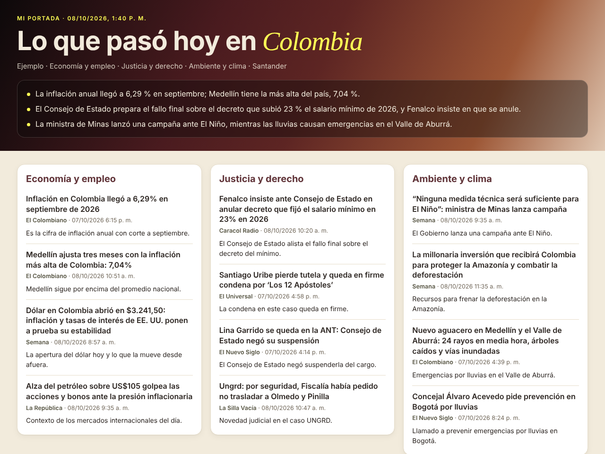

# Mi portada de noticias de Colombia

**[Español](#español) · [English](#english)**

## Español

Una **skill de Claude** que te pregunta qué temas y qué región te interesan y, cada vez que se lo pidas, te arma tu portada de noticias de Colombia: un tablero con lo más importante de las últimas 24 horas, con el titular, la fecha y el enlace de cada medio.

**Ábrelo aquí:** https://estado-x.github.io/noticias-colombia/

### Qué hace

- **Te pregunta una sola vez** tus temas (entre 13: política, economía, justicia, orden público, contratación pública, ambiente, salud, educación, tecnología, movilidad, campo, cultura y deportes), las palabras que quieres seguir («Catatumbo», «reforma pensional») y si quieres un departamento.
- **Te entrega tu propia skill**, `mi-portada-colombia`, con ese perfil guardado.
- **Cada día**, cuando escribes «mi portada», busca en la web, escoge entre 3 y 6 noticias por tema y te muestra un tablero con un resumen de tres líneas arriba.
- **Prefiere medios colombianos** verificados: 21 nacionales y medios regionales en 23 departamentos y Bogotá (lista en `skill/portada-colombia/references/medios.md`).

### Cómo se instala

1. Descarga [`descargas/portada-colombia.zip`](descargas/portada-colombia.zip) sin descomprimirlo.
2. En Claude, ve a **Configuración › Capacidades › Skills** y pulsa **Subir skill**.
3. En un chat nuevo, con la búsqueda web encendida, escribe «instala mi portada» y responde las preguntas.
4. Claude te entrega `mi-portada-colombia.zip`. Súbelo igual, desactiva `portada-colombia` y escribe «mi portada».

Necesitas un plan de Claude que permita skills (Pro, Max, Team o Enterprise), con la **ejecución de código** activa. Guía oficial: [Using Skills in Claude](https://support.claude.com/en/articles/12512180-using-skills-in-claude).

### Cómo funciona

| Archivo | Qué hace |
|---|---|
| `skill/portada-colombia/SKILL.md` | Las instrucciones para Claude: modo instalación (pregunta y arma tu skill) y modo portada (busca, escoge y arma el tablero) |
| `skill/portada-colombia/references/temas.md` | Los 13 temas y sus términos de búsqueda |
| `skill/portada-colombia/references/medios.md` | Medios nacionales y regionales, verificados el 08/10/2026 |
| `skill/portada-colombia/assets/tablero.html` | La plantilla del tablero. Claude solo llena el bloque de datos |
| `skill/portada-colombia/scripts/crear_mi_portada.py` | Valida tus respuestas y arma `mi-portada-colombia.zip` |
| `scripts/empacar.py` | Arma la descarga y el ejemplo de esta página |
| `index.html`, `ejemplo/` | La página de presentación y un ejemplo real del 08/10/2026 |

No hay servidor, base de datos ni claves. Todo lo hace Claude en tu cuenta.

### Úsalo o adáptalo

- ¿Otros temas o medios? Edita `temas.md` o `medios.md` y vuelve a empacar: `python3 scripts/empacar.py` (biblioteca estándar de Python 3.9 o superior).
- ¿Otro país? Cambia las dos listas y los textos de `SKILL.md`.
- Para probar el armado de la skill personalizada sin Claude: escribe un `perfil.json` como `{"temas": ["Ambiente y clima"], "palabras": [], "departamento": "Nariño"}` y corre `python3 skill/portada-colombia/scripts/crear_mi_portada.py --perfil perfil.json --salida salida/`.
- La rama por defecto es `main`. Para publicar tu copia en GitHub Pages: Settings → Pages → rama `main`, carpeta raíz.

### Límites

- Depende de la búsqueda web de Claude: lo que encuentra puede variar de un día a otro y de una cuenta a otra.
- Muestra titulares y enlaces; no copia el texto de las noticias.
- El resumen y las líneas de «por qué importa» las escribe Claude y pueden tener errores. Verifica en la fuente.
- No tiene opinión política ni ordena los medios por preferencia.
- Algunos departamentos no tienen un medio regional verificado en la lista; para ellos la skill busca por el nombre del departamento.

### Crédito

Inspirado en **[newsnow](https://github.com/ourongxing/newsnow)** de ourongxing (licencia MIT): la idea de una portada de noticias con columnas por fuente que cada quien organiza. Este repositorio es una versión nueva, escrita desde cero como skill de Claude y pensada para Colombia. No reutiliza código de newsnow.

Los titulares del ejemplo son de sus medios: El Colombiano, Semana, La República, Caracol Radio, El Universal, El Nuevo Siglo, La Silla Vacía y Vanguardia.

Hecho por **[Estado X](https://estadox.com)** · Código con licencia MIT.

---

## English

A **Claude skill** that asks which topics and which region you care about and then, whenever you ask, builds your own Colombian news front page: a board with the most important stories of the last 24 hours, each with the outlet's headline, date and link.

**Open it here:** https://estado-x.github.io/noticias-colombia/

### What it does

- **Asks you once** for your topics (out of 13: politics, economy, justice, public order, public procurement, environment, health, education, technology, mobility, rural affairs, culture and sports), keywords you want to follow and, optionally, one department (Colombia's states).
- **Gives you your own skill**, `mi-portada-colombia`, with that profile saved inside.
- **Every day**, when you type «mi portada», it searches the web, picks 3 to 6 stories per topic and shows a board with a three-line summary on top.
- **Prefers verified Colombian outlets**: 21 national outlets plus regional media in 23 departments and Bogotá (list in `skill/portada-colombia/references/medios.md`).

### How to install

1. Download [`descargas/portada-colombia.zip`](descargas/portada-colombia.zip) without unzipping it.
2. In Claude, go to **Settings › Capabilities › Skills** and click **Upload skill**.
3. In a new chat, with web search on, type «instala mi portada» and answer the questions.
4. Claude hands you `mi-portada-colombia.zip`. Upload it the same way, turn off `portada-colombia` and type «mi portada».

You need a Claude plan that supports skills (Pro, Max, Team or Enterprise) with **code execution** turned on. Official guide: [Using Skills in Claude](https://support.claude.com/en/articles/12512180-using-skills-in-claude).

### How it works

| File | What it does |
|---|---|
| `skill/portada-colombia/SKILL.md` | Instructions for Claude: setup mode (asks and builds your skill) and front-page mode (searches, picks and builds the board) |
| `skill/portada-colombia/references/temas.md` | The 13 topics and their search terms |
| `skill/portada-colombia/references/medios.md` | National and regional outlets, checked on 08/10/2026 |
| `skill/portada-colombia/assets/tablero.html` | The board template. Claude only fills in the data block |
| `skill/portada-colombia/scripts/crear_mi_portada.py` | Validates your answers and builds `mi-portada-colombia.zip` |
| `scripts/empacar.py` | Builds the download and the example on this page |
| `index.html`, `ejemplo/` | The landing page and a real example from 08/10/2026 |

No server, database or API keys. Claude does everything in your own account.

### Use it or adapt it

- Different topics or outlets? Edit `temas.md` or `medios.md` and repackage: `python3 scripts/empacar.py` (Python 3.9+ standard library only).
- Another country? Swap both lists and the text in `SKILL.md`.
- To test the personalized-skill builder without Claude: write a `perfil.json` like `{"temas": ["Ambiente y clima"], "palabras": [], "departamento": "Nariño"}` and run `python3 skill/portada-colombia/scripts/crear_mi_portada.py --perfil perfil.json --salida salida/`.
- The default branch is `main`. To publish your copy on GitHub Pages: Settings → Pages → branch `main`, root folder.

### Limits

- It relies on Claude's web search, so results can vary from day to day and from account to account.
- It shows headlines and links; it does not copy the articles.
- The summary and the «why it matters» lines are written by Claude and can be wrong. Check the source.
- It takes no political stance and does not rank outlets by preference.
- Some departments have no verified regional outlet on the list; for those, the skill searches by department name.

### Credit

Inspired by **[newsnow](https://github.com/ourongxing/newsnow)** by ourongxing (MIT license): the idea of a news front page with one column per source that each person arranges. This repository is a new version, written from scratch as a Claude skill and built for Colombia. It does not reuse newsnow code.

Headlines in the example belong to their outlets: El Colombiano, Semana, La República, Caracol Radio, El Universal, El Nuevo Siglo, La Silla Vacía and Vanguardia.

Made by **[Estado X](https://estadox.com)** · Code under the MIT license.
